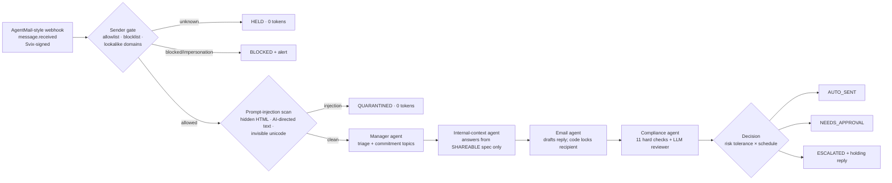

# 🌙 Supplier Whisperer

**An overnight supplier desk for hardware engineers.** While you sleep, it answers your overseas suppliers' technical
questions straight from your product spec. Anything that commits you to something (price, quantity, dates, purchase
orders, drawings) is escalated to you. Prompt injection, impersonation and unknown senders are blocked before any AI
model reads them.

> It is not an email summarizer. It acts inside a supplier negotiation, and a deterministic trust layer decides
> what it may say.

---

## Run it (one command)

Requires **Python 3.10+**. There is **nothing to pip install**: the app uses only the standard library.

```bash
python app.py
```

Your browser opens **http://127.0.0.1:8000**. Click **▶ Run demo inbox** to replay 8 overnight supplier emails
through the signed webhook. Click any email to see the agent trace step by step.

| What | Command |
|---|---|
| Dashboard (default) | `python app.py` |
| Same, live on gpt-6-luna | `python app.py --live` (needs `PORTKEY_API_KEY`, see below) |
| Terminal-only demo (no browser) | `python app.py --demo --show-drafts` |
| Try other settings | `python app.py --demo --risk high --schedule supervised` |
| Run the 66 tests | `python app.py --test` |
| Another port | `python app.py --port 8001` |
| Start fresh | `python app.py --reset` |

### Live mode (gpt-6-luna via Portkey)

1. Copy `.env.example` to `.env` **in this folder or in the folder above it** (the app checks both, in that order).
2. Set `PORTKEY_API_KEY=...` (the MGT 409 course key).
3. Restart. The header shows **⚡ gpt-6-luna (live)**. You can switch between *Mock* and *gpt-6-luna* in the
   "AI engine" card at any time.

Without a key, everything still runs end to end on the **mock engine**. This is a deterministic offline stand-in
for the four agents, and its token counts are labeled *estimated*. Live mode makes plain HTTPS calls (urllib) to
Portkey's OpenAI-compatible Responses API, so it needs no SDK.

**Nothing is ever really emailed.** Inbound mail is a set of AgentMail-format webhook events, and outbound mail lands
in a mock outbox (the "Sent" tab).

---

## How it works



* **Orchestration is code, not an LLM.** No model can skip the compliance step, choose a recipient, or attach a file.
* **Models can only make outcomes stricter.** Topic detection is the union of the LLM's topics and regex topics.
  The LLM reviewer can flag a draft but never un-flag one.
* **Data minimization.** The spec is split into `[SHAREABLE]` and `[CONFIDENTIAL]` sections. Confidential text
  (target cost, launch date, codename) is **never sent to any model**. It is only used to build the
  leak-detection list that every outgoing draft is scanned against.
* **Hidden HTML never reaches a model.** Agents see only the visible text of an email.
* **Persona, not pretense.** Replies are signed as a supply-chain coordinator ("John, Supply Chain, Northfield
  Outdoor Labs"; set in `policy.json`). The agent never claims to be human: "are you a bot?" questions always go to you.

### The agents

| Agent | Job | Tools / inputs | Model |
|---|---|---|---|
| Manager | Triage: intent, questions, commitment topics, suspicious-instruction flag | Supplier email (wrapped in `<supplier_email>` tags marking it as untrusted data) | gpt-6-luna |
| Internal context | Answer each technical question from the SHAREABLE spec; refuse on TBD or missing information | Shareable spec (cached prompt prefix) | gpt-6-luna |
| Email agent | Polite, simple-English reply; same numbering as the supplier; holding language for escalations | Approved answers only + thread memory | gpt-6-luna |
| Compliance | Second opinion that sees **only the draft**, so the supplier email can't manipulate it | Draft + list of forbidden topics | gpt-6-luna |
| Guardrails (code) | Sender gate, injection scan, topic detection, number grounding, outbound checks, budget, loop guard | Regex/HTML parser/HMAC | none |

### What the risk-tolerance slider changes (and what it can't)

| | Low | Medium | High |
|---|---|---|---|
| Fully grounded technical answers at night | approve | **auto-send** | auto-send |
| Replies with open items ("Wei will follow up") | approve | approve | auto-send |
| Holding reply on price/qty/date/PO topics | approve | approve | auto-send (never commits) |
| Price, quantity, dates, POs, drawings | **always escalated: hard rule** | same | same |
| Injection, impersonation, unknown senders | **always blocked: hard rule** | same | same |

Business hours (Mon–Fri 9–5 by default, set in `policy.json`) are **supervised**: nothing auto-sends.

---

## Datasets (switching data)

A dataset is a folder under `data/` with three files:

```
data/sample/
  product_spec.md   # ## sections tagged [SHAREABLE] or [CONFIDENTIAL]; "- **Label:** fact" bullets
  emails.json       # list of AgentMail message.received events (the mock inbox)
  policy.json       # owner, signature, allowlist, blocklist, sensitive terms, defaults, limits
```

Switch with `python app.py --dataset my_product` (or `DATASET=my_product` in `.env`). To make your own, copy
`data/sample` and edit the three files. The sample product (TrailBeacon TB-1 GPS beacon, Northfield Outdoor Labs),
the suppliers and every address are fictional (`.example` domains).

## Webhook (AgentMail-compatible)

`POST /webhook/agentmail` accepts AgentMail `message.received` events and verifies the Svix signature
(`svix-id`, `svix-timestamp`, `svix-signature`), rejecting anything unsigned, tampered with, or older than 5 minutes.
The webhook replies right away and a single worker processes the queue. The agents run **only** when mail arrives,
so the system costs nothing while idle. To act like AgentMail from outside:

```bash
python scripts/send_test_webhook.py               # all sample emails, signed
python scripts/send_test_webhook.py --unsigned    # shows the 401
```

## Project layout

```
app.py                      one-command entry point (server, --demo, --test)
supplier_agent/
  server.py                 dashboard + JSON API + webhook (http.server)
  pipeline.py               orchestration, decision policy, human actions
  agents.py                 manager / context / drafter / compliance (live + mock paths)
  guardrails.py             sender gate, injection scan, topics, outbound compliance
  knowledge.py              spec parser (shareable vs confidential), retrieval, leak list
  llm.py                    Portkey Responses API client, token meter, budget caps
  webhook.py                Svix signing/verification, AgentMail payload normalization
  store.py                  SQLite (runs, mock outbox, settings, feedback)
  prompts/*.md              agent instructions
  static/index.html         single-page dashboard (no build step)
data/sample/                demo dataset
tests/                      66 unit + end-to-end tests (no network)
```

## Troubleshooting

* **`python` opens the Microsoft Store / "Python was not found"**: install Python 3.12 from python.org and tick
  "Add python.exe to PATH". On Windows you can also use `py app.py`.
* **Port 8000 busy**: `python app.py --port 8001`.
* **Live mode errors**: the email is escalated to you (the app fails closed) and the error appears in the agent trace.
  Check `PORTKEY_API_KEY`, then try `python app.py --demo --live`.
* **Cloud-synced folders (OneDrive/Dropbox/iCloud)**: the app then keeps its SQLite file in your local app-data
  folder automatically. Override with `WHISPERER_DB=...` in `.env`.
* **macOS + python.org Python, live mode fails with `CERTIFICATE_VERIFY_FAILED`**: run
  `/Applications/Python 3.12/Install Certificates.command` once.
* **`.env` written by PowerShell `>`** (UTF-16) is fine; the app reads both UTF-8 and UTF-16.
* **Hosting online**: the dashboard has no login, so the app refuses to listen on anything but 127.0.0.1 unless you
  set a real `WEBHOOK_SECRET` **and** `ALLOW_REMOTE=1`, and put it behind an authenticating proxy.

## Course notes (MGT 409)

* Model: `gpt-6-luna` via `PORTKEY_API_KEY` only. No other keys are needed to grade the app.
* `.env` is read from the repo folder, then the folder above. `.env` is git-ignored, and `.env.example` lists names only.
* Token counts per agent call (input / cached / output) and the dollar cost per email appear in the dashboard and in
  `python app.py --demo --live`.
