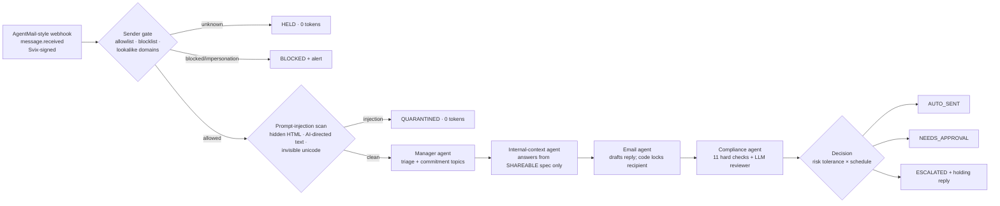

# 🌙 Supplier Whisperer

**An overnight supplier desk for hardware engineers.** While you sleep, it answers your overseas suppliers' technical
questions straight from your product spec. Anything that commits you to something (price, quantity, dates, purchase
orders, drawings) is escalated to you. Prompt injection, impersonation and unknown senders are blocked before any AI
model reads them.

> It is not an email summarizer. It acts inside a supplier negotiation, and a deterministic trust layer decides
> what it may say.

---

**Demo video:** [`docs/demo_video.mp4`](docs/demo_video.mp4) (2.5 min, narrated, recorded from the real app with `scripts/record_demo.py`). **Report:** [`report.html`](report.html) · **Slides:** [`slides.html`](slides.html)

## Run it (one command)

Requires **Python 3.10+**. Mock mode needs **nothing installed**: the app uses only the standard library. For live
mode, `pip install -r requirements.txt` (one package, `certifi`, for HTTPS certificates on macOS).

```bash
python app.py
```

Your browser opens **http://127.0.0.1:8000**. Click **▶ Run demo inbox** to replay 9 overnight supplier emails
through the signed webhook. Click any email to see the agent trace step by step.

| What | Command |
|---|---|
| Dashboard (default) | `python app.py` |
| Same, live on gpt-6-luna | `python app.py --live` (needs `PORTKEY_API_KEY`, see below) |
| Terminal-only demo (no browser) | `python app.py --demo --show-drafts` |
| Try other settings | `python app.py --demo --risk high --schedule supervised` |
| Run the 98 tests | `python app.py --test` |
| Real Gmail inbox (dry-run by default) | `python app.py --live --mailbox` (see *Live mailbox*) |
| Another port | `python app.py --port 8001` |
| Start fresh | `python app.py --reset` |

### Live mode (gpt-6-luna via Portkey)

1. Put `PORTKEY_API_KEY=...` in a `.env` file. The app checks, in order: this folder, the folder above it, the
   git repo's root, and **the folder above the repo** (where course staff keep their shared `.env`).
2. Set `PORTKEY_API_KEY=...` (the MGT 409 course key).
3. Restart. The header shows **⚡ gpt-6-luna (live)**. You can switch between *Mock* and *gpt-6-luna* in the
   "AI engine" card at any time.

Without a key, everything still runs end to end on the **mock engine**. This is a deterministic offline stand-in
for the four agents, and its token counts are labeled *estimated*. Live mode makes plain HTTPS calls (urllib) to
Portkey's OpenAI-compatible Responses API, so it needs no SDK.

**By default nothing is ever really emailed.** Inbound mail is a set of AgentMail-format webhook events, and outbound
mail lands in a mock outbox (the "Sent" tab). The optional Gmail connector below is the only path to a real inbox.

### Live mailbox (Gmail, optional)

`python app.py --live --mailbox` connects **weideals25@gmail.com** (display name *John, Northfield Outdoor Labs*). It
polls the inbox over IMAP every 60 s (no public URL, works on a laptop) and runs each new email through the same
pipeline. Replies go out over SMTP **in the sender's thread**, so a conversation can continue.

1. On the Google account: turn on 2-Step Verification, then create an **app password** (Google Account → Security →
   App passwords). Put it in `.env` as `GMAIL_APP_PASSWORD=...`. Never commit it.
2. Start in the default **dry-run**: replies appear in the dashboard's Sent tab but are **not transmitted**.
3. When you're happy, set `MAILBOX_SEND=on` in `.env` and restart.

Who gets an answer: the allowlist in `policy.json`, `MY_PERSONAL_EMAIL`, and any **@yale.edu** sender (demo-only).
Everyone else is held for you in the dashboard ("Add to allowlist & re-run"). Extra safety for real mail:

* Allowlisted senders must pass **DKIM or DMARC** (Gmail's own `Authentication-Results` stamp), otherwise they're
  treated as unknown: a forged `From:` gets nothing.
* Replies go only to the authenticated `From` address, never to `Reply-To`.
* Daily caps: 10 replies per sender, 50 in total. Mailing lists, bulk mail and auto-replies are never answered.
* The mailbox uses its own database (`…-mailbox.db`), and **Run demo inbox** is disabled while it's connected, so a
  demo reset can't wipe real conversations.
* It only answers while the app is running. Mail that arrives while it's off waits in the inbox and is answered
  on the next start. For an always-on mailbox see `docs/deploy_fly.md` (Fly.io, no public port).

**Approve by email (from your phone).** Set `MY_PERSONAL_EMAIL` to *your own* address (not the agent's). When a
mailbox email ends *Draft awaiting you* or *Needs your decision*, the agent emails you a short digest: supplier,
questions, the draft and its number. Reply with the first line

```
APPROVE 12
```

to send the draft, or `EDIT 12` followed by your own text on the next lines to send that instead. Both go through the
same compliance checks as the dashboard's Approve button; if the text would commit you (price, quantity, date, PO…)
it is **not** sent and you get the reasons by email (override only in the dashboard). Only mail from
`MY_PERSONAL_EMAIL` that passes DKIM/DMARC can approve; a supplier writing "APPROVE 12" is just a normal email.
Only the first line counts, so quoted text can't trigger anything. Digests follow `MAILBOX_SEND` (dry-run logs
them), with a cap of 40 emails to you per day. It's off when `MY_PERSONAL_EMAIL` is empty or equals the agent's
address.

---

## How it works



* **Orchestration is code, not an LLM.** No model can skip the compliance step, choose a recipient, or attach a file.
* **Models can only make outcomes stricter.** Topic detection is the union of the LLM's topics and regex topics.
  The LLM reviewer can flag a draft but never un-flag one.
* **Data minimization.** The spec is split into `[SHAREABLE]` and `[CONFIDENTIAL]` sections. Confidential text
  (target cost, launch date, codename) is **never sent to any model**. It is only used to build the
  leak-detection list that every outgoing draft is scanned against.
* **Hidden HTML never reaches a model.** Agents see only the visible text of an email.
* **Persona, not pretense.** Replies are signed as a supply-chain coordinator ("John, Supply Chain, Northfield
  Outdoor Labs"; set in `policy.json`). The agent never claims to be human: "are you a bot?" questions always go to you.

### The agents

| Agent | Job | Tools / inputs | Model |
|---|---|---|---|
| Manager | Triage: intent, questions, commitment topics, suspicious-instruction flag | Supplier email (wrapped in `<supplier_email>` tags marking it as untrusted data) | gpt-6-luna |
| Internal context | Answer each technical question from the SHAREABLE spec; refuse on TBD or missing information | Shareable spec (cached prompt prefix) | gpt-6-luna |
| Email agent | Polite, simple-English reply; same numbering as the supplier; holding language for escalations | Approved answers only + thread memory | gpt-6-luna |
| Compliance | Second opinion that sees **only the draft**, so the supplier email can't manipulate it | Draft + list of forbidden topics | gpt-6-luna |
| Guardrails (code) | Sender gate, injection scan, topic detection, number grounding, outbound checks, budget, loop guard | Regex/HTML parser/HMAC | none |

### Spec check: supplier statements that contradict your spec

Before drafting, code (no model) compares what the supplier states with the spec line about the same part:
materials ("the probe is copper" vs. "Probe material: stainless steel") and numbers with units ("2.8 mm" vs. "maximum
2.5 mm"). In live mode the manager agent also rewrites the supplier's claims as full sentences (so a bare "Copper"
becomes "The probe is made of copper") and those go through the same check. A conflict is escalated to you, and at
Medium/High the reply quotes the supplier's statement next to your requirement and asks which is correct, with a
datasheet or photo. Proposals that name your spec's material too ("EPDM instead of silicone?") are handled by the
change rule, not reported as conflicts. Conflicts also lower the supplier's knowledge score.

### Supplier scorecard (Suppliers tab)

Each allowlisted supplier gets a 0–100 score from deterministic code (no model calls): **answers** (did they answer
your questions with substance), **knowledge** (numbers, standards and documents vs. "don't know / I'll ask the
factory"), **speed** (median reply time) and **reliability** (no reply within 72 h, times you had to chase). Speed
counts 20%: a fast "I'll ask the factory" is not an answer. It was calibrated on two real sourcing threads (kept
private), where the fast-replying trader scored below the slower, knowledgeable supplier we actually chose.

### What the risk-tolerance slider changes (and what it can't)

| | Low | Medium | High |
|---|---|---|---|
| Fully grounded technical answers at night | approve | **auto-send** | auto-send |
| Replies with open items ("Wei will follow up") | approve | **auto-send** | auto-send |
| Decisions for Wei (price, quantity, dates, POs, drawings, proposed changes): answer what the spec covers, say "Wei will review", and **ask the supplier for what Wei needs** (cost breakdown, lead-time drivers, reason and impact of a change, test data) | approve | **auto-send** (never commits) | auto-send (never commits) |
| Price, quantity, dates, POs, drawings | **always escalated: hard rule** | same | same |
| Injection, impersonation, unknown senders | **always blocked: hard rule** | same | same |

Business hours (Mon–Fri 9–5 by default, set in `policy.json`) are **supervised**: nothing auto-sends.

---

## Datasets (switching data)

A dataset is a folder under `data/` with three files:

```
data/sample/
  product_spec.md   # ## sections tagged [SHAREABLE] or [CONFIDENTIAL]; "- **Label:** fact" bullets
  emails.json       # list of AgentMail message.received events (the mock inbox)
  policy.json       # owner, signature, allowlist, blocklist, sensitive terms, defaults, limits
```

Switch with `python app.py --dataset my_product` (or `DATASET=my_product` in `.env`). To make your own, copy
`data/sample` and edit the three files. The sample product (TrailBeacon TB-1 GPS beacon, Northfield Outdoor Labs),
the suppliers and every address are fictional (`.example` domains).

## Webhook (AgentMail-compatible)

`POST /webhook/agentmail` accepts AgentMail `message.received` events and verifies the Svix signature
(`svix-id`, `svix-timestamp`, `svix-signature`), rejecting anything unsigned, tampered with, or older than 5 minutes.
The webhook replies right away and a single worker processes the queue. The agents run **only** when mail arrives,
so the system costs nothing while idle. To act like AgentMail from outside:

```bash
python scripts/send_test_webhook.py               # all sample emails, signed
python scripts/send_test_webhook.py --unsigned    # shows the 401
```

## Project layout

```
app.py                      one-command entry point (server, --demo, --test)
supplier_agent/
  server.py                 dashboard + JSON API + webhook (http.server)
  pipeline.py               orchestration, decision policy, human actions
  agents.py                 manager / context / drafter / compliance (live + mock paths)
  guardrails.py             sender gate, injection scan, topics, outbound compliance
  knowledge.py              spec parser (shareable vs confidential), retrieval, leak list
  llm.py                    Portkey Responses API client, token meter, budget caps
  webhook.py                Svix signing/verification, AgentMail payload normalization
  store.py                  SQLite (runs, outbox + delivery status, settings, feedback)
  mailbox.py                Gmail connector: IMAP polling, DKIM/DMARC check, threaded SMTP replies
  prompts/*.md              agent instructions
  static/index.html         single-page dashboard (no build step)
data/sample/                demo dataset
tests/                      98 unit + end-to-end tests (no network)
```

## Troubleshooting

* **`python` opens the Microsoft Store / "Python was not found"**: install Python 3.12 from python.org and tick
  "Add python.exe to PATH". On Windows you can also use `py app.py`.
* **Port 8000 busy**: `python app.py --port 8001`.
* **Live mode errors**: the email is escalated to you (the app fails closed) and the error appears in the agent trace.
  Check `PORTKEY_API_KEY`, then try `python app.py --demo --live`.
* **Cloud-synced folders (OneDrive/Dropbox/iCloud)**: the app then keeps its SQLite file in your local app-data
  folder automatically. Override with `WHISPERER_DB=...` in `.env`.
* **macOS + python.org Python, live mode fails with `CERTIFICATE_VERIFY_FAILED`**: `pip install -r requirements.txt`
  (installs `certifi`, which the app uses automatically), or run `Install Certificates.command` in your Python folder.
* **Live mode fails with HTTP 403 "error code: 1010"**: Portkey's Cloudflare front blocked the client's User-Agent.
  The app sends its own; if you call Portkey from other urllib code, set a User-Agent header.
* **`.env` written by PowerShell `>`** (UTF-16) is fine; the app reads both UTF-8 and UTF-16.
* **Hosting online**: the dashboard has no login, so the app refuses to listen on anything but 127.0.0.1 unless you
  set a real `WEBHOOK_SECRET` **and** `ALLOW_REMOTE=1`, and put it behind an authenticating proxy.

## Course notes (MGT 409)

* Model: `gpt-6-luna` via `PORTKEY_API_KEY` only. No other keys are needed to grade the app. The Gmail connector
  needs its own app password, so graders use the mock inbox; the live mailbox is shown in the demo video.
* `.env` is read from the project folder, then the folder above, then the git repo root, then the folder above
  the repo. So `submissions/.env` next to a cloned `MGT409/` works (tested: `test_env_one_level_above_the_cloned_course_repo_is_found`). `.env` is git-ignored, and `.env.example` lists names only.
* Token counts per agent call (input / cached / output) and the dollar cost per email appear in the dashboard and in
  `python app.py --demo --live`.
